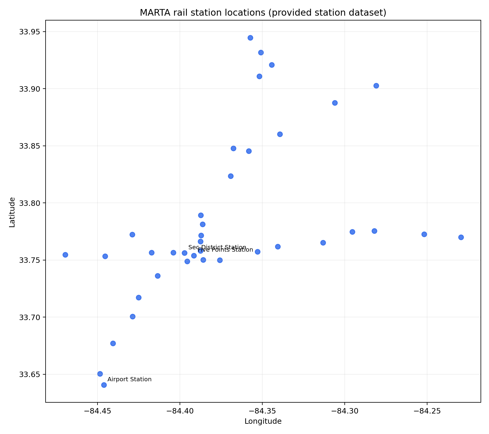
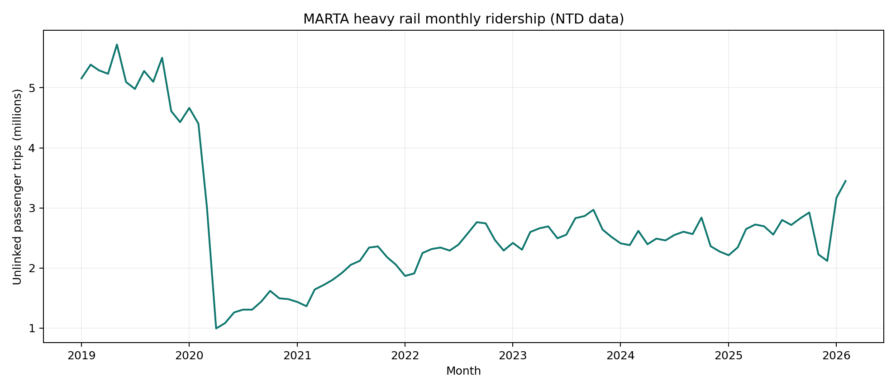
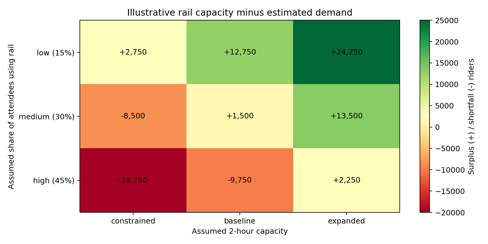

# MARTA Rail & FIFA World Cup 2026 — Exploratory Data Analysis

An independently reconstructed, reproducible Python portfolio analysis inspired by the **ARCTIC SciSynth 2026 Real-World Data Analysis track** at Georgia State University.

> **Scope and provenance:** This repository is a new analysis based on educational datasets provided by the camp. It is **not** a recovered copy of my original final presentation, and its model results are **illustrative scenarios, not MARTA operational forecasts**.

## Research question

How might different levels of event-related rail demand compare with hypothetical passenger-throughput capacity during a major event in Atlanta?

## What is included

- Geographic scatter plot of the 38 stations in the provided rail station dataset.
- Monthly historical heavy rail unlinked passenger trips from the provided NTD extract.
- Nine sensitivity scenarios combining assumed stadium attendance, rail mode share and hypothetical two-hour rail throughput.
- Generated charts and machine-readable scenario results.

## Key findings

- The station dataset contains **38 unique stations**.
- The 3×3 scenario model assumes **75,000 attendees**, **15% / 30% / 45%** rail mode share, and **14,000 / 24,000 / 36,000** passengers of hypothetical two-hour throughput.
- **These capacity values are illustrative assumptions** and must not be interpreted as measured service capacity or an operational readiness assessment.
- Run the script to regenerate exact outputs and summary statistics.

## Visualizations







## Run locally

Requires Python 3.10+.

```bash
python -m venv .venv
# Windows PowerShell:
.\.venv\Scripts\python.exe -m pip install -r requirements.txt
.\.venv\Scripts\python.exe src\analyze.py
# macOS/Linux:
# source .venv/bin/activate && pip install -r requirements.txt && python src/analyze.py
```

Outputs are written to `figures/` and `results/`. No external network calls are required.

## Repository structure

```text
MARTA-WorldCup-2026/
├── data/
│   ├── processed/         # Rail stations, station frequencies, NTD ridership, event references
│   └── raw/               # Census ACS tract tables (reference inputs)
├── src/analyze.py         # Original reconstructed analysis script
├── figures/               # Generated charts
├── results/               # Generated CSV outputs
├── requirements.txt
├── LICENSE                # Original educational material license, retained
└── README.md
```

## Limitations

1. Monthly systemwide NTD ridership cannot establish passenger demand for a particular game or station.
2. Ridership figures may be affected by faregate undercounting, as noted in the source curriculum.
3. The hypothetical two-hour throughput is not derived from train headways, carriage occupancy, service schedules or real crowd-flow measurements.
4. Mode-share percentages and 75,000 attendance are scenario inputs, not observations.
5. The geographic station plot uses raw latitude/longitude and is not a distance-accurate projected map.
6. This model does not address crowd management, transfers, platform crowding, service disruptions or train directionality.
7. Event-reference records are inherited from the teaching dataset and should not be treated as verified current match schedules.

## Data provenance and acknowledgments

Educational source: **ARCTIC SciSynth 2026 — Real-World Data Analysis**, Georgia State University, curriculum designed by **Andalib Samandari**. Original repository: [arctic-gsu/scisynth-2026](https://github.com/arctic-gsu/scisynth-2026). Source materials credit MARTA GTFS, Federal Transit Administration National Transit Database and U.S. Census ACS. Data in `data/processed` are **instructor-prepared**, not my own original data collection. See `data/PROVENANCE.md`.

The curriculum identifies CC BY 4.0 for content and MIT for code. The original license text is retained in `LICENSE`; new analysis code in `src/analyze.py` was written separately for this portfolio reconstruction. This project is not affiliated with or endorsed by MARTA or FIFA.
